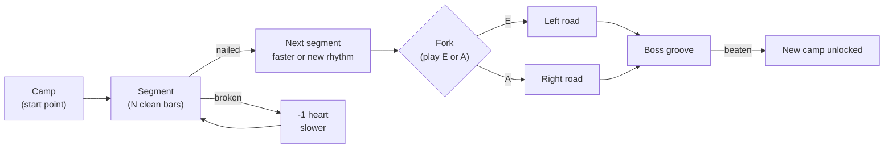

# Groove Road (roguelite design)

**Goal:** make picking up the bass irresistible. Practice becomes a run down a road. You keep playing while you're nailing it; the road gets faster and stranger; you choose where it goes **by playing**. It's a roguelite: failing ends the run, but you keep what you unlocked and you can start at the hard part you actually need.

## 1. Principles carried over

- **Ears first.** The road is a **map strip**, not a note highway. The playing view stays as it is now: the current bar only, judged by the lock-in rules. A *Fog* modifier hides even that.
- **Never stop the groove.** A run is one continuous performance. Changes happen at bar lines, announced by a **drum fill**, the way a band would do it.
- **Strict.** A clean bar means every note in the pocket, on the right pitch, nothing extra (the lock-in rules).
- **Start at your edge.** Camps let you skip what you've already mastered.

## 2. The run

- **Segment.** One rhythm, and a goal of N clean bars in a row. N ramps from 2 to 4 to 8 with depth. Nail it and the next segment starts at the bar line.
- **Adapting.**
  - A nailed segment brings **+4 BPM** or a **rhythm mutation**, alternating.
  - A broken segment (no clean run within its bar budget) **costs a heart** and **−6 BPM**, and you retry the same rhythm.
- **Mutations within a region** draw from its rhythm deck. For example, Pulse Plains goes: quarters → quarter-8th-8th-quarter → dotted quarter + 8th → 8th-note runs → rests in odd places.
- **Hearts.** 3 per run. Zero hearts ends the run. The **highlight reel** follows (§6).

## 3. Forks: choose by playing

- Before a fork, a **choice bar** plays: the drummer drops to hi-hat and both options are announced (a word on the map strip, plus a sound cue).
- **Play low E on the 1 to go left, A on the 1 to go right.** A wrong pitch, or missing the 1, means you go **straight on** (the default road).
- **Choices get harder deeper in:**
  1. E or A on the 1
  2. E or A on the **&** of 4 (a pickup into the new road)
  3. A **two-note figure** (E–A vs. A–E) on beats 1 and 2
  4. A **rhythm**: play quarters to go left, or the clave figure to go right

**Example roads at a fork:**

| Road | What changes |
|---|---|
| Fast lane | the same rhythm, +12 BPM |
| Ghost road | the drums thin out: 2 & 4, then 1 only, then silent bars |
| Off the Grid | odd spots, displacement, groups of 3 across the bar line |
| Odd road | 7/8 (2+2+3), then 5/8, then 9/8 (needs the meter engine) |
| Feel road | laid back, then pushed, then switching feel every 4 bars |

## 4. Regions, bosses and camps (the Time Path as a map)

| Region | Rhythm deck | Boss groove | Camp unlocks |
|---|---|---|---|
| Pulse Plains | quarters, 8ths, simple rests | Motown | Syncopation City |
| Syncopation City | 16ths, anticipations, Funk | Chic / Disco | Off-Grid Swamp, Feel Valley |
| Off-Grid Swamp | odd spots, displacement, groups over 4 | Funk (on the one) | Odd-Meter Mountains |
| Feel Valley | laid back / pushed / switching | Neo-soul | (side region) |
| Odd-Meter Mountains | 5/8, 7/8, 9/8 | Rush-style 4/4 ↔ 7/8 | Math-Rock Summit |
| Math-Rock Summit | 11/8, 13/8, changing meters | Angine de Poitrine-style riff | the end (endless mode) |

**Roguelite rules:**
- **Camps.** Beating a boss unlocks a camp at the start of the next region. Each run starts at any unlocked camp.
- **Permanent unlocks.** Unlocks carry over between runs: new rhythms in the decks, styles, drum kits, modifiers. A failed run still earns progress, e.g. "first time through the 7/8 pass".
- **Hardcore** (optional): one heart, start at the Plains, a separate leaderboard against yourself.

## 5. Modifiers (relics)

- **Curses** (more points, and sometimes a fork option on its own):
  - Narrow Pocket (±10 ms)
  - Smoke Break (click on the 1 only)
  - Fog (no note blocks)
  - Laid-Back Curse (target +15 ms)
  - Short Notes (lengths count)
- **Blessings** (found after bosses):
  - Metronome Angel (the full click returns for 2 bars, once per run)
  - +1 heart
  - Wide Pocket for one segment

## 6. Rewards you hear

**The band joins as you nail segments.** One layer per nailed segment; one layer drops on a broken segment.

1. Click only
2. Kick + snare (backbeat)
3. Hi-hat groove with ghost notes
4. Percussion (shaker / tambourine)
5. Keys: simple chord stabs that follow the root you play, so it sounds like *your* band
6. A short melodic hook on top

At full band you're playing a song. Losing the hook when you slip is a strong pull to lock back in.

- **Highlight reel** at the end of a run: your best nailed segments stitched together, plus your first segment against your best one.
- **Daily Groove:** a seeded road that's the same every day, so you can compare your own days.

## 7. Engine work

| Need | Status |
|---|---|
| Strict clean-bar judging, rhythm masks, multi-bar phrases, takes | ✅ built (lock-in) |
| Pitch class of each note (for forks) | ✅ built |
| **Seamless handover:** change rhythm / tempo / click at a bar line mid-run, with a fill | small: engine applies queued config at the next bar |
| Drum fills and layered arrangement (band layers, keys stabs, hook) | new: arrangement module + synth voices |
| Run state: segments, hearts, decks, forks, camps, unlocks (pure, tested) | new |
| Map strip UI and highlight reel | new |
| Meter engine (7/8 etc.) for the Odd road | planned in TIME_PATH §4 |

## 8. First slice (prove it's fun)

1. **Run engine:** pure run state (segments, hearts, adapt, decks) and queued bar-line handover in the engine.
2. **Pulse Plains → Syncopation City**, endless and adaptive, with a drum fill on every change.
3. **One fork:** Fast lane vs. Ghost road, chosen with **E or A on the 1**.
4. **Band layers 1–4** (drums and percussion; we already synthesize drums), then keys stabs.
5. **Map strip, hearts, end-of-run highlight reel.**
6. Camps and unlocks persisted in localStorage.

Then: bosses, more forks, modifiers, and the Odd road after the meter engine.
