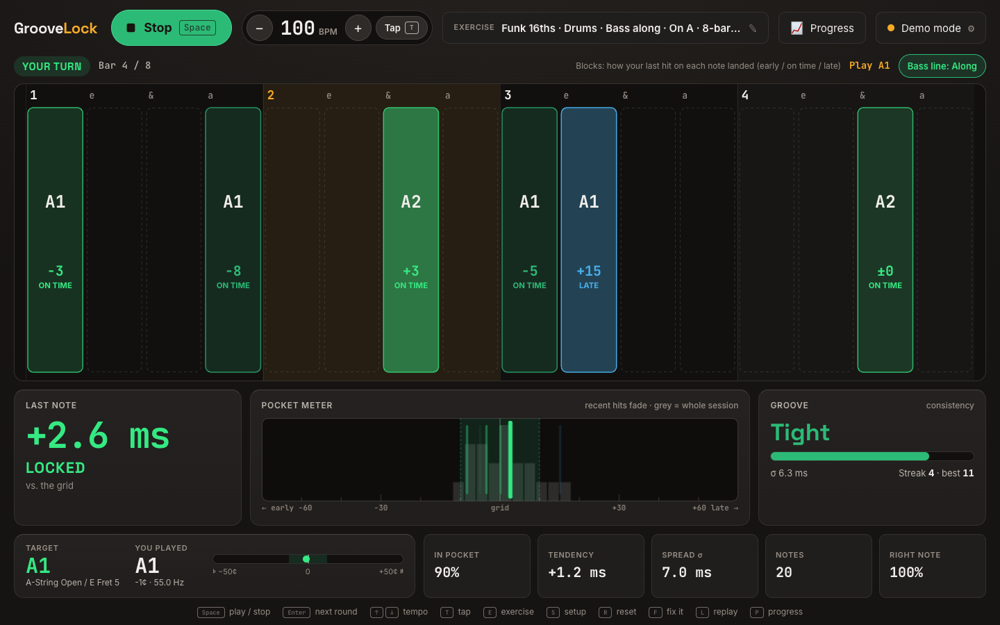
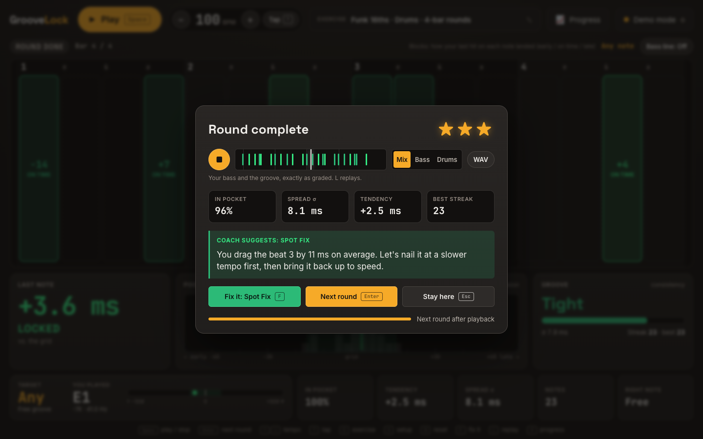

# GrooveLock

**A practice companion that helps bass players become masters of time.**

GrooveLock listens to your bass through an audio interface, plays a groove for you to lock into,
and shows you, to the millisecond, how each note landed: early, on time or late. Then it plays your
round back so you can *hear* it, works out what's going wrong, and gives you a drill aimed at
exactly that. The drill starts at a level you can pass and gets harder as you improve.

**▶ Try it: [pokowaka.github.io/groove-lock](https://pokowaka.github.io/groove-lock/)** (Chrome,
with an audio interface). No instrument at hand? Open
[the demo](https://pokowaka.github.io/groove-lock/?demo), which plays a simulated bassist.



---

## Why

For a bass player, time *is* the job. But practicing with a metronome gives you almost no feedback:
you can't tell whether you're 10 ms ahead or 30 ms behind, whether you rush one particular note, or
whether your groove falls apart the moment the click goes away. Rhythm games are motivating, but they
mostly train you to *react to the screen* with loose timing windows, not to keep time yourself.

GrooveLock tries to combine the two:

- **Honest measurement:** sample-accurate note detection plus latency calibration, so the numbers
  reflect what you actually played. Detector accuracy is checked against real recordings in the
  test suite.
- **A loop that makes you want to keep going:** short rounds, an instant verdict, stars, streaks, a
  coach and visible progress.
- **Ears first:** nothing moves on screen that you could time against unless you ask for it. The
  goal is an internal pulse, not good reactions.

## What you can do with it

| | |
|---|---|
| **Play rounds, hands-free** | Press Space: one bar of count-in, then an 8-bar round. The results card plays your take back, and the next round starts on its own. You never have to put the bass down. |
| **See every note** | Each note block in the lane shows how your last hit landed (`−12 EARLY`, `+3 ON TIME`, `+15 LATE`) in green, orange or blue. A pocket meter, consistency meter (σ) and streaks track the session. |
| **Hear yourself** | Every round is recorded and played back on the results card: your bass and the groove, aligned exactly as they were graded. Switch between Mix / Bass / Drums, replay, or download a WAV. |
| **Get coached** | The Coach looks at your last few rounds, picks the one thing to fix ("you rush the 4-& by 13 ms"), and offers a drill: Spot Fix, Lay It Back, On Top, Steady Quarters or Ghost Drummer. Drills level up 2-up / 2-down, start one level below your best, and count as mastered once you beat them on two different days. |
| **Practice real grooves** | Straight grids, Motown, funk 16ths, shuffle and 8th-note octaves, with a synthesized drum kit and reference bass. Options: click on every beat, 2 & 4, 1 only or the &s; silent bars; laid-back or pushed feel targets; echo/demo modes; note drills (cycle of 4ths, random notes). |
| **Track progress** | Round history and drill levels are saved in your browser. The Progress drawer shows the last 7 days and every drill's level. |



## Getting started

You need **Chrome**, a bass (or guitar), and an audio interface. GrooveLock was built around a
**Focusrite Scarlett Solo**, but any interface works.

1. Plug the bass into the interface's instrument input (on a Scarlett press **INST**) and set the
   gain so hard plucks stay green. GrooveLock warns you when the input clips.
2. Open the app and press **S** (Setup) → **Connect audio input**. Choose the interface as the
   output too, so the click and your bass share one clock.
3. Run **Loopback ping** once to measure your setup's latency: patch the headphone/line out into the
   input, or hold a headphone cup over the pickup. **Tap calibrate** is the alternative: pluck along
   with a slow click.
4. Close Setup and press **Space**.

| Key | Action | Key | Action |
|---|---|---|---|
| `Space` | Play / stop (or next round) | `E` | Exercise settings |
| `Enter` | Next round now | `S` | Setup (audio, calibration, diagnostics) |
| `Esc` | Stay on the results / close drawer | `P` | Progress |
| `↑` `↓` | Tempo ±1 (`Shift` ±5) | `F` | Start the Coach's drill |
| `T` | Tap tempo | `X` | Exit the drill |
| `L` | Replay the take | `C` | Calibrate (when the Coach suggests it) |
| `R` | Reset session stats | | |

Tip: enable **Direct Monitor** on the interface so you hear your bass with zero latency.

## How it works

- **Note detection in the audio thread.** An `AudioWorklet` runs a cycle-safe onset detector (a
  32 ms envelope, so a low E at 41 Hz never re-triggers on its own waveform) and YIN pitch detection
  on every 128-sample block. Re-plucks on a ringing string must show a real rise in energy, which
  keeps clipped or ringing low notes from being counted twice.
- **Latency you can trust.** A loopback "sonar" ping measures the round trip (up to 400 ms), and
  tap calibration is the fallback. The input context runs on the interface's own clock, so the
  delay can't creep up during a session. Setup shows the clock source and any drift.
- **One timeline.** Generated grooves produce `TargetNoteEvent`s that the grader matches plucks
  against (each beat is graded once). The same model is meant to drive songs and a scrolling note
  highway later.
- **Recordings re-render the groove.** Takes combine your recorded instrument audio with an offline
  re-synthesis of the exact drum and click events that were played. That keeps the backing clean and
  sample-aligned.
- **Diagnostics.** Setup → Diagnostics records both inputs plus the app's timing log.
  `tools/analyze_diagnostics.py` checks the detector against the waveform, clock health and drift
  offline.

More detail: [`src/DESIGN.md`](./src/DESIGN.md) (audio and DSP architecture),
[`UX_VISION.md`](./UX_VISION.md) (product direction, design principles, playtest decisions) and
[`ROADMAP.md`](./ROADMAP.md) (feature milestones).

## Where it's heading

Next up, roughly in order: a **daily 2-minute Time Check** benchmark with a progress chart; a
**responsive band** that adds layers when you're locked in and strips back when you drift; sharper
drills (subdivision click, isolating a single rhythm); then note length and dynamics, a fretboard
view, and a scrolling highway with songs. See [`UX_VISION.md`](./UX_VISION.md) for the full plan.

---

## Development

```bash
nvm use          # Node 24 (see .nvmrc); Node >= 22 works
npm ci           # install exactly what package-lock.json pins
npm run dev      # dev server on http://127.0.0.1:8080 (add ?demo to preview without a bass)
npm run typecheck
npm test         # Vitest: DSP, grading, scoring, coach, takes, calibration, real-recording fixtures
npm run build    # production bundle in dist/
```

Every push to `main` runs typecheck, tests and build in GitHub Actions and deploys `dist/` to GitHub
Pages.

Useful extras:

- `?demo` simulates a player; `?demo&demoLatency=250` simulates an uncalibrated high-latency setup.
- `npx vite-node tools/replay-onsets.ts file.wav` replays a recording through the onset detector.
- `python3 tools/analyze_diagnostics.py groovelock-diag-….json` analyzes a diagnostics recording
  (needs numpy).

```text
groove-lock/
├── index.html                 # Play view, results card, Exercise / Setup / Progress drawers
├── UX_VISION.md               # Product direction, principles, playtest log
├── ROADMAP.md                 # Feature milestones
├── src/
│   ├── DESIGN.md              # Audio/DSP architecture
│   ├── main.ts                # UI controller
│   ├── dsp/                   # Pure DSP: onset detection, YIN pitch, loopback ping, pitch math
│   ├── audio/
│   │   ├── capture.worklet.ts # AudioWorklet: detection, metering, recording, diagnostics
│   │   ├── audio-engine.ts    # Input/output contexts, scheduler, count-in, rounds, clock lock
│   │   ├── drum-synth.ts      # Synthesized click, drums and reference bass
│   │   ├── take.ts            # Round recordings: alignment, offline re-render, playback, WAV
│   │   ├── diagnostics.ts     # Diagnostic recorder (WAV + JSON timing log)
│   │   └── clock-drift.ts     # Input-delay drift estimate
│   ├── groove/
│   │   ├── timeline.ts        # TargetNoteEvent model, note drills
│   │   ├── patterns.ts        # Groove patterns, click placement, reference bass modes
│   │   ├── pocket-grader.ts   # Matches plucks to targets, timing stats
│   │   ├── scoring.ts         # Judgments, groove meter, streaks, round summary
│   │   ├── drills.ts          # Coach: diagnosis, drill ladders, staircase
│   │   ├── history.ts         # Round history, drill progress, mastery
│   │   ├── calibration.ts     # Latency rules and latency-issue detection
│   │   ├── storage.ts         # Validated settings persistence
│   │   └── tap-tempo.ts
│   └── ui/                    # Canvas lane & pocket meter, controls, demo player
├── tests/                     # Vitest suites + fixtures/ (real Scarlett recordings)
└── tools/                     # Offline analysis and replay scripts
```

## License

Licensed under the [Apache License, Version 2.0](LICENSE).
