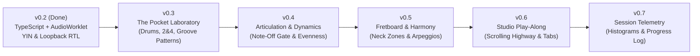

# GrooveLock — Product & Engineering Roadmap

This document outlines the multi-milestone engineering roadmap for **GrooveLock**, progressing from
micro-timing & pocket feel drills (`v0.3`) to articulation/dynamics grading (`v0.4`), fretboard &
harmonic mastery (`v0.5`), scrolling song/YouTube play-along (`v0.6`), and longitudinal practice
telemetry (`v0.7`).

---

## Milestone `v0.3` — The Pocket Laboratory (Rhythm, Feel & Drum Grooves)

Focuses on real-world bass rhythm craft: locking into a kick and snare, practicing with sparse
reference clicks, playing syncopated groove patterns, and deliberately controlling pocket placement.

- **Audible Reference & Synthesized Drum Engine (`src/audio/drum-synth.ts`):**
  - **Metronome Click Placement Modes:**
    - `all`: All 4 quarter-note beats
    - `backbeat-2-4`: Beats **2 & 4 only** (classic Carol Kaye / Victor Wooten backbeat drill)
    - `one-drop-1`: Beat **1 only** per bar
    - `offbeat-and`: Off-beat **`&`** (eighth-note upbeats) only
  - **Pure Web Audio Drum Kit (`soundMode: 'drums'`):**
    - Zero-asset synthesized studio **Kick** (pitch-swept sine + click transient), **Snare** (body
      triangle + bandpass noise burst), and **Hi-Hat** (high-pass metallic noise network) routed
      through [`outputCtx`](./src/audio/audio-engine.ts).
- **Syncopated Groove Pattern Library (`src/groove/patterns.ts`):**
  - Selectable rhythmic templates with rests and active target steps:
    - `uniform`: Uniform subdivision grid (Quarter, 8th, Triplet, 16th)
    - `motown-pocket`: Dotted-Quarter + Eighth Motown bass pocket (`1`, `2-&`, `3`, `4`)
    - `funk-16th`: Syncopated 16th-note funk pocket (`1`, `1-a`, `2-&`, `3`, `3-e`, `4-&`)
    - `shuffle-swing`: Swung 8th-note shuffle ($62\%$ triplet swing ratio)
    - `octaves-8th`: Driving 8th-note pulse
  - **16-Step Bar Pattern Indicator:** Visual step sequencer strip showing active target steps and
    current beat/subdivision progress. Grading evaluates plucks against active pattern targets
    without penalizing bars where the player rests.
- **Intentional Pocket Feel Offset (`pocketCenterMs`):**
  - Shift the target pocket zone center between **Dead Center ($0\text{ ms}$)**, **Laid-Back /
    Behind the Beat ($+12\text{ ms}$)**, and **Pushed / On Top of the Beat ($-8\text{ ms}$)**.
- **Auto-Tempo Speed Trainer:**
  - Automatically step up tempo (`+2 BPM` or `+4 BPM`) every 4 active bars when in-pocket accuracy
    meets or exceeds $85\%$.

---

## Milestone `v0.4` — Note Duration, Muting & Plucking Dynamics

On bass, _when you stop a note_ (left/right hand muting) and _how evenly your index and middle
fingers pluck_ are just as critical as attack timing.

- **Note-Off / Gate-Length Grading (Staccato vs. Legato):**
  - Extend [`BassOnsetAnalyzer`](./src/dsp/onset.ts) to emit a sample-accurate `note-off` event when
    the $32\text{ ms}$ `sustainEnv` drops below the mute floor, grading note duration against target
    gate lengths.
- **Plucking Hand Dynamics & Evenness Meter:**
  - Measure `peakRms` dB variance across consecutive plucks so players can train even index/middle
    finger velocity.
- **Percussive Ghost Note (`X`) Targets:**
  - Grade muted dead-note transients (`pitch === null` + high `hfRms` spike) as intentional rhythmic
    hits in funk patterns.

---

## Milestone `v0.5` — Fretboard Visualizer & Harmonic Drills

- **Interactive 4-String / 5-String Bass Fretboard:**
  - Real-time neck visualization highlighting detected pitches and enforcing optional **Fret Zone
    Constraints** (e.g., _"Frets 5–9 only, no open strings"_).
- **Chord-Tone / Walking Bass Arpeggio Exercises:**
  - Multi-bar harmonic progressions (`ii–V–I`, `12-Bar Blues`) requiring Root on Beat 1, 3rd on Beat
    2, 5th on Beat 3, and 7th on Beat 4.

---

## Milestone `v0.6` — Scrolling Rhythm Highway & Song Play-Along

- **Horizontal Note & Rhythm Highway:**
  - Studio-styled scrolling timeline rendering upcoming
    [`TargetNoteEvent`](./src/groove/timeline.ts) blocks, rests, and real-time early/late hit pips.
- **Backing Track & Tab Beatmap Loader:**
  - Synchronize local audio stems or YouTube playback with JSON / MIDI / Guitar Pro bass beatmaps.

---

## Milestone `v0.7` — Deep Session Telemetry & Practice Log

- **Micro-Timing Distribution Histogram & Per-Beat Heatmap:**
  - Visualize timing spread across $-60\text{ ms}$ to $+60\text{ ms}$ and highlight specific
    subdivisions where the player tends to rush or drag.
- **Longitudinal Practice Log (`IndexedDB` / JSON Export):**
  - Track session $\sigma$ consistency and in-pocket rate across weeks of practice.
