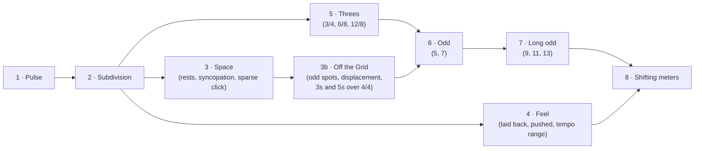

# The Time Path (curriculum design)

**Goal:** a clear route from "lock to quarter notes" to "play odd and shifting meters with ease", built from short exercises that all stay about one thing: **locking into the groove**.

## 1. The core idea: odd meters are 2s and 3s

An odd meter is easier to feel as a chain of **short (2) and long (3) groups** of eighth notes than as "7 beats":

| Meter | Felt as | Count |
|---|---|---|
| 4/4 | 2+2+2+2 | 1 & 2 & 3 & 4 & |
| 6/8 | 3+3 | 1 2 3 4 5 6 |
| 5/8 / 5/4 | 3+2 or 2+3 | 1 2 3 1 2 |
| 7/8 | 2+2+3, 3+2+2, 2+3+2 | 1 2 1 2 1 2 3 |
| 9/8 | 2+2+2+3 (aksak) or 3+3+3 | … |
| 11/8 | 3+3+3+2, 2+2+3+2+2 | … |

So the path for odd meters is:
1. A steady **eighth-note pulse**.
2. Feeling **3-groups** as easily as 2-groups.
3. Chaining the groups.
4. Keeping the chain alive while the click gets sparse or goes silent.

This is the same skill set the 4/4 track trains, so the two tracks share a foundation.

## 2. Shape: a small skill tree, not a line

- Each **stage** has 3–5 **exercises**. Each exercise reuses the existing machinery: a level ladder, the 2-up/2-down staircase, mastery after passes on 2 different days, and an entry level you can pass.
- A stage is **complete** when all of its exercises are mastered. The next stages then light up as "recommended".
- **Guide, not gate:** everything stays playable. The Path only recommends what's next, in line with §7.6.

## 3. Stages and exercises

| # | Stage | Exercises (★ = new type) | Engine needs |
|---|---|---|---|
| 1 | **Pulse** | Steady Quarters · Ghost Drummer (3+1) · ★Tempo Ladder (slow is hard too) | exists |
| 2 | **Subdivision** | ★Subdivide (hear 8ths, play quarters; the 8ths fade out) · 8ths · 16ths · triplets | subdivision click independent of the target |
| 3 | **Space** | ★Wait for It (rests before the target) · Backbeat Bounce (click on 2&4 → 1 only → only the &s) · syncopated grooves (Motown, Funk 16th) · Ghost Drummer 2+2 → 1+3 | step-mask patterns, 1+3 gap |
| 3b | **Off the Grid** | ★Odd Spot · ★Displacement · ★Strange Rhythms · ★Groups Over 4 (see §3.1) | step masks on a 16th/triplet grid, patterns longer than 1 bar |
| 4 | **Feel** | Lay It Back · On Top · ★Feel Shifter (switch feel every N bars) | per-phrase feel target |
| 5 | **Threes** | 3/4 quarters · 6/8 pulse (3+3) · 12/8 shuffle · ★Group Heads (play only the 1 of each group) | **meter model** |
| 6 | **Odd** | 5/8 (3+2, 2+3) · 7/8 (2+2+3 → 3+2+2 → 2+3+2) · 7/4 · Group Heads in 5 and 7 · odd-meter riffs | meter model, odd drum patterns |
| 7 | **Long odd** | 9/8 (2+2+2+3, 3+3+3) · 11/8 · 13/8 · click on group heads only → bar 1 only → silent bars | sparse odd click |
| 8 | **Shifting** | ★Meter Switch (7/8 + 8/8, 4/4 + 3/4, 5+7) · repeating odd riffs with silent bars, at speed | per-bar meter sequence |

**Ladder knobs per exercise (one at a time):** tempo ↑, tolerance ↓, click density ↓ (all → group heads → bar 1 → silent bars), then feel.

### 3.1 Off the Grid (a classic teacher's exercise)

You play in strange places inside a plain 4/4 bar while the click stays normal. This is where your own clock gets tested hardest, because the click never lands where you do.

| Exercise | What you play | Ladder (one knob at a time) |
|---|---|---|
| **Odd Spot** | One note per bar on a single unusual spot, e.g. only the "a" of 2 | `&` → `a` → `e` (usually the hardest; easy to rush) → triplet spots → two spots per bar → the spot moves every bar |
| **Displacement** | A groove you already know, shifted by an 8th, then a 16th, so it starts on the "e" | shift size ↓, tempo ↑, click sparser |
| **Strange Rhythms** | Generated sparse, lopsided 1–2 bar rhythms. You hear it first (call and response, ears first), then play it back | more notes, more off-beat spots, longer phrases, a new rhythm every round |
| **Groups Over 4** | Accented groups of 3 (or 5) sixteenths running across the 4/4 bar lines (3+3+3+3+4, or a pure 3-cycle that realigns after 3 bars) | 3s → dotted 8ths → 5s, click sparser |

- **Groups Over 4 bridges into odd meters.** You learn to feel 3- and 5-groups while 4/4 keeps running underneath. That's exactly the skill 7/8 and 11/8 need.
- **Grading:** few notes per bar means fewer hits per round, so these rounds run longer before the Coach judges anything (the minimum-evidence rule).
- **Cheap to build:** this stage needs only step masks on the existing 16th/triplet grid, plus patterns that span several bars. It does **not** need the meter engine, so it can ship first.

### 3.2 Note length (release timing)

**Feasibility, checked on real recordings:**
- A muted note is easy to spot. The level falls about **40 dB in 100–150 ms**, while a held low E barely decays at all (about 0–1 dB per 100 ms).
- In a 62 BPM diagnostics session, the method found the end of **131 of 133 notes**.
- The notes there lasted a median of **244 ms**, about a quarter of a beat. The player used *staccato* quarters, quite consistently (middle half of notes within ±20 ms).

**How it would work:**
- **Detector:** after each onset, the note ends at the first point where the level stays ≥ 15 dB below the note's peak for 30 ms, or when the next note starts (legato). It applies the same latency compensation as onsets, so the release time should be accurate to roughly ±10–15 ms.
- **Target:** each pattern step gets a written length (`gateBeats` already exists for the reference bass), e.g. "stop on the &".
- **Judgment:** the release is graded like an onset, relative to the target end, in the same colours: **cut short** (orange-red) / **on time** (green) / **held too long** (blue). It's a second, separate line on the results card. In the lane, a thin bar under each block shows how long you actually held the note.
- **Coach:**
  - diagnoses "you cut notes short" or "you let notes ring into the next one"
  - adds a **Note Length** exercise: play the same rhythm staccato, then legato, then switch every bar.

**Risks to test first:**
- Strings ringing in sympathy after a mute. The pitch tracker can confirm the note's pitch is gone.
- Open strings ringing on.
- Notes that are left to ring until they fade, which isn't a mute.

These get tests built from real recordings before anything goes into the UI.

### 3.3 Styles: the payoff at the end of each stage

The same skill sounds completely different from one style to the next. Each **style** bundles:
- a drum groove
- a bass rhythm
- a **pocket**: where you sit against the beat, plus how much swing
- a tempo range

Every stage ends with a style groove, the **"boss level"**, where its skill turns into music. That stage-ending groove is also the transfer check from §7.5.

| Stage | Boss style | Why it fits | Drums | Pocket |
|---|---|---|---|---|
| 1 Pulse | **Motown** | steady quarters and dotted rhythms, never rushed | backbeat, tambourine on 2 & 4 | dead centre |
| 2 Subdivision | **Disco / Chic** | tight 16th syncopation and octaves, locked to the hi-hat | four-on-the-floor kick, 16th hats, open hat on the &s | centre, *tight* (small tolerance) |
| 3 Space | **Reggae one drop** | leave beat 1 empty, land late and heavy, lots of space | kick + rim on **3** only, half-time feel | laid back (+15–25 ms) |
| 3b Off the Grid | **Funk (on the one)** | 16th syncopation that always comes home to the 1 | ghosted 16ths, snare 2 & 4 | centre, slightly on top |
| 4 Feel | **Neo-soul** | lazy, behind-the-beat 16ths that still feel even | loose, swung 16ths | far behind (+20–30 ms) |
| 5 Threes | **Shuffle / 12/8 blues** | the triplet feel | swung hats, backbeat | swing ratio |
| 6 Odd | **Prog rock (Rush-style)** | driving 8ths that switch into 7/8 and 5/4 sections | driving rock beat in odd meters | pushed (on top) |
| 7–8 | **Math rock (Angine de Poitrine-style)** | repeating odd riffs, shifting meters | odd-meter grooves | centre, tight |

- **Original patterns written in each style**, not copies of real songs.
- **Prog rock connects the two goals.** Rush moves between 4/4 rock and odd sections all the time, so it links the 4/4 track to the odd-meter goal.
- **Note length is gradable** (see §3.2): *when you stop* a note is timing too. Reggae's short stabs, Motown's held notes and Chic's tight 16ths are all graded on both when the note starts and when it ends. Ghost notes are not covered yet.
- **Engine needs:**
  - drum grooves per style (today the kick and snare are hard-coded)
  - any pocket offset in ms, instead of the 3 fixed values
  - a swing amount per style
  - half-time drum feel

**Riffs and patterns stay simple.** The challenge is time, not note reading. Patterns are single-pitch rhythms in the lane, and an odd-meter "riff" is just a rhythm mask over the grouping.

## 4. Engine work for odd meters (TDD, before any UI)

1. **Meter model:** `{ unit: 4 | 8, groups: number[] }`, e.g. 7/8 = `{unit: 8, groups: [2,2,3]}`. 4/4 becomes `{unit: 4, groups: [1,1,1,1]}`, so existing behaviour is unchanged.
2. **Patterns:** a bar is resolved from meter + step mask, replacing the hard-coded 4 beats. Step labels follow the groups (`1 2 | 1 2 | 1 2 3`).
3. **Click and drums:** a strong accent on bar 1, a medium accent on each group head, soft pulses otherwise. Drums put the kick on group heads and the snare on the last group or the backbeat, with a pattern per meter.
4. **Count-in:** one bar in the actual meter and grouping, so you *hear* the 2+2+3 before you play.
5. **Lane:** bar width follows the bar length. Faint brackets above the blocks show the groups.
6. **Gap modes, the Coach, history and storage** become meter-aware (they currently use `bar % 4`, beat 1–4 names, etc.).

## 5. Suggested build order

| # | Step | Status |
|---|---|---|
| 1 | Rhythm masks, multi-bar patterns, written note lengths | ✅ done (`src/groove/rhythm.ts`) |
| 1b | Release detector and note-length grading, with a held-length bar in the lane and a results-card line | ✅ done (`src/dsp/release.ts`, `src/groove/release-grading.ts`); needs real-instrument playtesting |
| 2 | Off the Grid stage (Odd Spot, Displacement, Groups Over 4, Strange Rhythms), plus Note Length | ✅ done (`src/groove/off-grid.ts`, `drills.ts`) |
| 3 | Path UI: the Path drawer (P) with "Next up" (N) | ✅ done (`src/groove/path.ts`) |
| 4 | Style kit and 4/4 boss styles | next |
| 5 | Meter model, then stages 5–6 | |
| 6 | Remaining 4/4 exercise types | |
| 7 | Stages 7–8 | |

1. **Step masks + multi-bar patterns + written note lengths** (tests first), designed so the meter model can slot in later.
1b. **Release detector** (offline on real recordings first, then live), graded like onsets. Adds release colours to the results card and lane.
2. **Off the Grid stage** (Odd Spot, Displacement, Strange Rhythms, Groups Over 4). New, hard, and fast to deliver.
3. **Path UI.** A Path drawer (or the Progress drawer becomes the Path) shows the stages, your mastery, and **"Next up"**, one click to start, hands-free. Map the existing drills into stages 1, 3 and 4.
4. **Style kit:** drum grooves per style, any pocket offset, swing amount. Then the 4/4 boss styles: Motown, Chic, Reggae, Funk, Neo-soul.
5. **Meter model** (engine, tests first), then the **stage 5–6 exercises** (Threes, 5 and 7). This is where the odd-meter goal starts to pay off.
6. Fill in the new 4/4 exercise types (Subdivide, Wait for It, Feel Shifter, Tempo Ladder).
7. Stages 7–8, with Prog rock and Math rock as the boss levels.

**Decisions (defaults):**
- **Odd-meter click:** strong accent on the 1, medium on each group start. This becomes a setting, so you can switch to the 1 only as a later level.
- **Final goal:** Math rock in the style of Angine de Poitrine, with Prog rock as the step before it.
