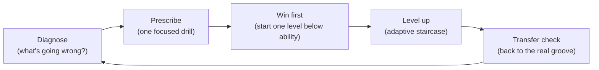

# GrooveLock — UX & Product Vision

> **Purpose of this document:** capture the UI/UX direction agreed on in the October 2026 design
> session so that work can be resumed in a fresh session without re-deriving it. Read this together
> with [`ROADMAP.md`](./ROADMAP.md) (feature milestones) and [`src/DESIGN.md`](./src/DESIGN.md)
> (audio/DSP architecture).

---

## 1. North Star

**GrooveLock should make practicing bass _exciting_ so that the player becomes a master of time.**

It is not just a measurement instrument. It is a **motivation engine wrapped around a
precision-timing core**. The DSP (sub-ms onset detection, YIN pitch, loopback calibration) is the
foundation; the UI's job is to turn those numbers into a loop the player _wants_ to come back to.

### Who it is for (decided)

| Question | Answer | Consequence |
|---|---|---|
| Audience | One adult player (the author) | Mastery & honest progress > cartoon gamification. No leaderboards. |
| Teacher involvement | None, solo practice | No teacher dashboards, assignments or share codes (for now). |
| Device | Laptop + Focusrite Scarlett Solo | Desktop landscape first (MacBook ~1440×900 / 1280×800). Phone/tablet: "don't break", nothing more. |
| Foot pedal | **No** | The app must flow **hands-free** without a pedal (see §4.1). |

---

## 2. Lessons From Other Music Apps & Games

| App | Best idea | What GrooveLock adopts |
|---|---|---|
| **Guitar Hero** | Juicy feedback, streaks, stars, readable-from-the-couch highway | Clear judgments, streaks, per-round stars, big readable Play view |
| **Rocksmith** | Real instrument as controller, dynamic difficulty, Riff Repeater, Guitarcade mini-games | Adaptive difficulty, short focused rounds, skill-targeted drills |
| **GarageBand** | Sounds great in 5 seconds; Drummer with personality | The backing band must sound good — it _is_ the reward |
| **FL Studio** | Step sequencer as a toy | Future **Groove Builder**: make your own groove, then practice it |
| **Melodics / Rhythm Heaven** | Daily habit + visible progress; games that train _feel_ not reading | Daily Time Check, personal bests, eyes-free modes |

### ⚠️ The trap: highways train _reaction_, not _time_

A note highway teaches players to react to what scrolls toward them. Mastery of time means an
**internalized pulse** that survives when the drummer drops out. Guitar Hero's ~±70 ms windows are
also far too forgiving — GrooveLock grades at ±10–25 ms. So every game mechanic must **progressively
remove crutches**:

- **Fading highway** — notes vanish before the hit line (osu! "Hidden").
- **Click dropout / Ghost Drummer** — the existing Gap Click trainer, framed as a challenge.
- **Eyes-free mode** — audio-only feedback; learn to _hear_ the pocket.
- **Reward consistency (σ), not just accuracy.** A player sitting a steady 10 ms behind the beat is
  _laid back_ — that's style, not error. The headline **Groove Meter** is driven by rolling σ.

---

## 3. Core Concepts

### 3.0 Glossary (shared vocabulary)

| Term | What it is |
|---|---|
| **Lane** (timeline lane) | The big strip showing one bar; becomes the scrolling highway later |
| **Note block** | One square in the lane per note you're asked to play, sized by its length; shows note name and how your last hit on it landed |
| **Rest** | Dashed outline in the lane: don't play here |
| **Last note** | Big readout: offset of your most recent hit + judgment |
| **Pocket meter** | Ruler of recent hits (fading) + grey session histogram |
| **Groove meter** | Consistency (σ) tier: Machine / Tight / Solid / Loose / Wobbly |
| **Round** | Count-in + N graded bars; ends with the **results card** |
| **Take** | The recording of a round (your bass + re-rendered groove) played back on the results card |
| **Coach / drill** | The Coach suggests one drill (a level ladder of settings) for what went wrong |

### 3.1 The Timeline Lane (the central element)

Beat lamps, the 16-step strip, the pocket ruler and the pluck log are all partial views of the same
data: `TargetNoteEvent`s + `GradedPluckEntry`s over time. They converge into **one horizontal lane**
that grows with the roadmap:

| Feature | Encoding on the lane |
|---|---|
| v0.3 timing offset | How your **last hit** on each note landed: signed ms + EARLY / ON TIME / LATE, tint, hit flash; dims if missed on the next pass. _Not averages (not meaningful while playing), no arrows (read as directions), no in-block gauge (confusing)._ |
| v0.3 pocket feel | Labels/tint are relative to the feel target (+12 / −8 ms) |
| v0.4 note-off / gate length | Tail length on the hit vs. target block length |
| v0.4 dynamics / evenness | Tick height / brightness |
| v0.4 ghost notes | `X` blocks |
| v0.5 chord tones | Chord-symbol lane above; degree labels (R/3/5/7) in blocks |
| v0.6 highway | Same lane, scrolling mode instead of fixed-bar mode |
| v0.7 per-beat heatmap | Per-note averages belong in Review / results, not the live lane |

**Rule:** build the step strip _as_ the first incarnation of the highway (fixed bar now, scroll mode
later) so no work is thrown away. **Position guides must not be predictive by default** (beat glow,
not a sweeping playhead) — see the playtest log in §9.

### 3.2 Musical judgments (instead of raw numbers first)

Relative to the feel target (`pocketCenterMs`) and tolerance window `w` (`pocketWindowMs`):

| Judgment | Rule | Color |
|---|---|---|
| **LOCKED** | \|Δ\| ≤ 0.4·w | Bright green |
| **POCKET** | \|Δ\| ≤ w | Green |
| **← RUSHED** | Δ < −w | Orange-red, arrow left |
| **DRAGGED →** | Δ > +w | Blue, arrow right |

Color is never the only signal (arrows + words). Raw ms remains visible but secondary.

### 3.3 Groove Meter (consistency)

Rolling σ over the last 16 hits mapped to a labeled meter:
`≤5 ms Machine · ≤9 Tight · ≤15 Solid · ≤24 Loose · >24 Wobbly`.
Plus an **in-pocket streak** counter and best streak.

### 3.4 Rounds (the core loop)

Practice happens in short **rounds** (default 8 bars):

1. **Count-in** — one bar of quarter clicks, always audible (even in backbeat/one-drop modes),
   not graded.
2. **Round** — N bars graded; lane shows `LISTEN` (call & response demo bar), `YOUR TURN`,
   `SILENT — KEEP IT GOING` (gap bars).
3. **Landing** — final downbeat sound; brief grace period so late final notes still grade.
4. **Results card** — stars (1–3), pocket %, σ, tendency, and **one** coaching tip
   (e.g. "You rush the `4-&` by 14 ms on average").
5. **Auto-continue** — countdown (default 6 s) then the next round starts with a count-in.
   Adaptive tempo: a 3★ round with Speed Trainer on bumps BPM for the next round.

"Continuous" (∞) round length keeps the old free-running behavior.

### 3.5 The Responsive Band (planned, step 2)

The mix reacts to how locked-in you are: in the pocket → hi-hat opens, ghost snares, extra layers;
drifting → layers drop out until you settle. The most music-native reward, and it works eyes-free.

---

## 4. Interaction Principles

### 4.1 Hands-free flow (no foot pedal)

Hands are on the bass. Every trip to the trackpad breaks the groove. Therefore:

- Count-in, rounds, auto-continue and auto-dismissing results — a whole session can run from one
  press of **Space**.
- Big click targets for anything that _is_ clicked; nothing essential hidden in dropdowns during play.
- Keyboard: `Space` play/stop · `Enter` start next round now · `Esc` cancel auto-continue / close
  drawer · `↑/↓` BPM ±1 (`Shift` ±5) · `T` tap tempo · `R` reset session · `E` exercise drawer ·
  `S` setup drawer.
- Future idea: **pluck gestures** as commands (e.g. two muted ghost notes = "retry"). Not built.

### 4.2 One screen, no scrolling while playing

The Play view must fit a ~800 px tall viewport: transport bar → timeline lane → readout / pocket
meter / groove meter → note + metrics strip. Settings live in drawers.

### 4.3 Setup is a one-time thing

Device, channel, threshold, latency, loopback ping and tap calibration live in a **Setup drawer**.
Calibration trust is foundational — a precise grader with wrong latency is a frustrating grader.
Later: make calibration a short "tap along to sync" mini-game.

### 4.4 Visual language

Keep the warm dark studio palette (adult-appropriate), but the Play view is **bold and readable from
1–2 m**: large numerals, high contrast, generous spacing. Avoid tiny 10 px uppercase mono labels for
anything important. Visible focus rings. Generic wording (no "MK-I", "YIN Pitch Lock" jargon in the
main view).

---

## 5. Information Architecture

| Screen | Contents | Status |
|---|---|---|
| **Play** | Transport, timeline lane, readouts, groove meter, metrics, results card | Step 1 (prototype) |
| **Setup** (drawer) | Audio devices, channel, meters, threshold, latency, calibration | Step 1 |
| **Exercise** (drawer) | Groove, click, feel, tolerance, gap, speed trainer, note drill, round length | Step 1 |
| **Progress / Review** | Session history, Daily Time Check, personal bests, histograms, pluck log | Step 3 |
| **Build** | Groove Builder step grid | Step 4 |

```
┌ GROOVELOCK  [▶ PLAY]  [−] 90 [+] BPM [TAP]   Exercise: Motown · 2&4 · Laid-back ✎   ● Live ⚙ ┐
├ TIMELINE LANE  (blocks ∝ duration · note labels · playhead · hit ticks · LISTEN/YOUR TURN)    ┤
├ +4.2 ms  LOCKED      │  Pocket meter (zone · ticks · fading hits · histogram)  │ Groove meter  ┤
├ Target E1 · Detected E1 +3¢          │  Pocket % · Mean · σ · Streak · Notes · Note match     ┤
└ key hints                                                                                       ┘
```

---

## 6. Phased Plan (supersedes ordering in ROADMAP.md for UI work)

| Step | Deliverable | Builds on |
|---|---|---|
| **1. Core loop** | One-screen Play view, timeline lane (fixed bar), judgments, Groove Meter, streaks, rounds + count-in + results card + auto-continue, Setup & Exercise drawers, keyboard control, tap tempo | Existing grader, patterns, synth |
| **2. The band** | Responsive mix, genre jam tracks (Motown, funk, one-drop, shuffle) | `drum-synth.ts`, bass guide |
| **3. Progress** | Drill list + personal bests, Daily Time Check (σ & drift at 3 tempos), IndexedDB history + JSON export, **ghost run** of your best attempt on the lane, Review screen with pluck log | ROADMAP v0.7 pulled forward |
| **4. Groove Builder** | FL-style step grid for bass rhythm + drums; practice what you build | `PatternStepDescriptor` |
| **5. Depth** | Note-off/dynamics/ghost notes, fretboard & chord tones, scrolling highway, songs | ROADMAP v0.4–v0.6 |

Drill ideas for step 3+ (each is an existing setting + a goal): **Ghost Drummer** (gap bars),
**Backbeat Bounce** (2 & 4 click), **Pocket Shifter** (8 bars laid-back, 8 pushed), **Echo Duel**
(call & response), **Steady Hands** (keep σ < X ms for 16 bars), **Drift** (8 bars no click, measure
tempo drift).

### Things deliberately _not_ prioritized

Fancy cents tuner (fretboard becomes the pitch view in v0.5) · more stat tiles (metrics strip +
Review instead) · polishing beat lamps (absorbed by the lane) · mobile layouts · leaderboards.

---

## 7. Coaching & Progression (the "Coach")

> Goal: help the player actually get better at staying on the beat. Find what's going wrong,
> prescribe a drill aimed at exactly that, **start it at a level they can pass** so they see they
> can do it, then level it up until the skill transfers back to real grooves.

### 7.1 The loop



**One focus at a time.** The Coach picks the single biggest weakness, says it in one sentence, and
offers one drill. Too many tips at once help nobody.

### 7.2 Diagnose: timing problems we can detect from data we already have

Every graded hit already carries offset, feel delta, step position, bar number and silent-bar flag.
Adding tempo and round history (persisted) unlocks the rest.

| Problem | How it shows in the data | Min. evidence |
|---|---|---|
| **Rushing / dragging overall** | Mean feel delta beyond ±0.5·w | ≥ 16 hits |
| **Unsteady** | σ > 0.75·w with a centered mean | ≥ 16 hits |
| **One trouble spot** | One step's mean differs from the overall mean by > 0.4·w (e.g. "you rush the 2-&") | ≥ 4 hits on that step |
| **Off-beats weaker than downbeats** | Off-beat (subIndex > 0) σ / mean vs. downbeats | ≥ 8 each |
| **Rushing after rests** | Notes that follow a rest step are early | ≥ 6 |
| **Rushing into the "one"** | Beat 1 early relative to other beats (common at bar lines) | ≥ 6 |
| **Leans on the click** | Silent-bar stats much worse than click-bar stats, or a drift trend (offsets creep in one direction) across silent bars | ≥ 2 silent bars |
| **Tempo-dependent** | Rushes at slow tempos / drags at fast ones (across rounds) | rounds at ≥ 2 tempos |
| **Can't control feel** | Misses laid-back / pushed targets while fine on the grid | feel rounds |

**Guardrails:**
- Never diagnose from a handful of notes. Require the minimum evidence above.
- Always judge relative to the **feel target**: a deliberate laid-back feel is not dragging.
- **Calibration sanity check:** a constant offset on *every* step at *every* tempo with low σ may
  be latency, not the player. Suggest re-checking calibration before telling them they drag.

### 7.3 Prescribe: drill library (each drill = existing settings + a goal + a level ladder)

| Drill | Fixes | Core idea | Ladder knobs (one at a time) |
|---|---|---|---|
| **Steady Quarters** | Unsteady | Quarters only, simple, slow | tempo ↑, tolerance ↓ |
| **Subdivide** | Unsteady, rushing at slow tempos | Hear 8ths/16ths while playing quarters, then the subdivisions fade | subdivision click volume ↓ → off, tempo ↓ (slow is harder!) |
| **Lay It Back** | Rushing | Laid-back feel target with drums | tolerance ↓, tempo ↑ |
| **On Top** | Dragging | Pushed feel target | tolerance ↓, tempo ↑ |
| **Spot Fix** | One trouble spot | Isolate the trouble rhythm (downbeat + the bad step only), loop it, then rebuild the full pattern | add pattern notes back, tempo ↑ |
| **Wait for It** | Rushing after rests / into the one | Patterns with rests before the target note; land the "one" | longer rests, sparser click |
| **Ghost Drummer** | Leans on the click | Click drops out for bars at a time | 3+1 → 2+2 → 1+3 silent → click on 2&4 → 1 only |
| **Backbeat Bounce** | Weak internal pulse | Click only on 2 & 4, then only on 1, then only on the &s | sparser click, tempo ↑ |
| **Tempo Ladder** | Tempo-dependent | Same groove at slow and fast extremes | widen the tempo range |
| **Feel Shifter** | Feel control | Alternate laid-back / on grid / pushed every N bars | shorter switch interval, tolerance ↓ |

New engine capabilities this needs (small): an **audible subdivision click independent of the target
pattern** (for Subdivide), **custom step-mask patterns** (for Spot Fix; also the Groove Builder's data
model), a **1+3 silent** gap mode, and a **per-phrase feel target** (for Feel Shifter).

### 7.4 Win first, then level up (adaptive staircase)

- Every drill has a **ladder of ~8–10 levels**. Each level changes **one** knob.
- **Entry level** = one level *below* the player's estimated ability, so the first round is a
  likely pass and they *see* they can do it.
- **Pass** a round = ≥ 80% in the pocket and σ ≤ 0.75·w. **Fail** = < 60%.
- **2 passes in a row → level up. 2 fails in a row → level down.** Otherwise stay. This keeps
  success around 70–85%, which is the "challenging but doable" zone.
- A drill is **mastered** when the target level is passed in 2 separate sessions (spacing makes it
  stick). Mastered skills appear on a skill map, the "time belts" from §6.
- Rounds chain automatically with auto-continue, and the level adjusts between rounds, so the whole
  drill runs hands-free.

### 7.5 Make progress visible

- Results card shows the **drill level bar** and a clear **"Level up!"** moment.
- **Before → after** on the focus metric: "Your 2-& rush: 14 ms → 4 ms."
- **Transfer check:** after a drill session, the Coach offers "Now try your groove again" and
  compares it with the earlier rounds. This is the real proof of improvement.
- The validated green / orange-red / blue language (§9) carries everywhere, e.g. the trouble step
  turns from orange to green over the session.

### 7.6 Session shape

1. **Time Check** (2 min diagnostic): quarters at 3 tempos, one phrase with silent bars, one
   syncopated groove. It produces the weakness profile and becomes the daily progress benchmark.
2. **Focus drill**: the Coach's one recommendation, staircased (≈ 5–10 min).
3. **Transfer check**: back to a real groove.
4. **Free play / jam**: no grading pressure.

Free practice (today's mode) stays available. The Coach is a guide, not a gate.

### 7.7 Build order (proposed)

> The curriculum that links these drills into one route, and extends them to odd meters, styles
> and note length, is in [TIME_PATH.md](./TIME_PATH.md).

| Step | What | Why first |
|---|---|---|
| **C1 "Fix it"** | Results-card tip becomes actionable: **[Fix it]** launches the matching drill at an achievable level, staircased; then "Back to your groove" | Smallest change that closes the loop, using today's settings |
| **C2 Diagnostics module** | Pure, tested analyzer over hit records (all rows in 7.2 that don't need history) | Better, evidence-based focus picking |
| **C3 Persistence** | Round history + drill levels (localStorage → IndexedDB) | Levels survive sessions; tempo-dependent analysis |
| **C4 Time Check + skill map** | Daily benchmark, mastery tracking, before/after charts | Long-term motivation |
| **C5 New drill capabilities** | Subdivision click, custom step masks (Spot Fix), 1+3 gaps, feel phrases | Unlocks the rest of the library |

---

## 8. Implementation Notes

- **No framework (yet).** Plain TypeScript modules: a controller (`main.ts`) plus view modules in
  `src/ui/`. Reconsider Preact/Lit only if screen count grows.
- **Canvas for real-time visuals** (lane, pocket meter), driven by `requestAnimationFrame` and the
  audio clock (`outputCtx.currentTime − outputLatency`), not `setTimeout` lamps.
- **Pure, unit-tested scoring logic** in `src/groove/scoring.ts` (judgments, groove meter, streaks,
  round summary, stars, coaching tip).
- Engine additions: count-in bar, round length (`maxBars`) with landing + grace period, bar-scheduled
  callback carrying bar timing for the lane, audio-clock accessor.

---

## 9. Status Log

- **2026-10-11** — Vision agreed (this doc). **Step 1 prototype built:**
  - New one-screen Play view (`index.html`, `src/style.css`), Exercise & Setup drawers with segmented
    controls (`src/ui/controls.ts`), results card with stars, tip, auto-continue countdown.
  - Canvas timeline lane (`src/ui/timeline-lane.ts`): blocks ∝ duration, sustain tails, per-step
    mini pocket gauges (magnified ±50 ms), tendency heat tint after 3 hits, hit flashes, count-in
    digits, LISTEN / SILENT overlays, audio-clock playhead.
  - Canvas pocket meter with session histogram (`src/ui/pocket-meter.ts`).
  - Pure scoring module + tests (`src/groove/scoring.ts`, `src/groove/tap-tempo.ts`,
    `tests/scoring.test.ts`).
  - Engine: 1-bar count-in, `roundBars` with landing hit + grace period, `onBarScheduled`,
    `onCountInBeat`, `onRoundComplete`, `getAudioClockSec()` (`src/audio/audio-engine.ts`).
  - Profile: `roundBars` (default 8) and `autoContinue` (default on).
  - Call & response "listen" bars are no longer graded or counted as misses.
  - Auto tempo is round-based in round mode (3★ → +N BPM); per-4-bar logic kept for Endless.
  - `?demo` URL flag simulates a player for previewing without an instrument.

- **2026-10-11 (first playtest)** — Feedback and decisions:
  - _The sweeping playhead pulls you to your eyes instead of your ears._ → Sweep is now opt-in via
    **Visual timing guide: Off · Beat glow · Sweep** (Exercise drawer). Default is **Beat glow**: the
    current beat column lights up as it sounds — orientation without anything to anticipate.
    Principle reinforced: **no predictive visuals by default.**
  - _The mini pocket gauge inside each block was confusing_ (read as "line the white line up with the
    green bar"). → Removed. Blocks now show plain text for your **average timing on that note**
    (`✓`, `← 12 ms`, `9 ms →`) plus tint and a hit flash; lane header says so.
  - _The bar along the bottom of each block was meaningless._ (It was the reference bass gate
    length.) → Removed; reintroduce only with note-off grading (v0.4) where it means something.
  - _Old red/blue hits lingered on the pocket meter._ → Hits fade out over ~2.5 s; the latest hit
    holds briefly then dims. Grey histogram remains as the session view.
  - Liked: the pocket meter and the overall UI direction.
  - **Liked a lot: the green / orange-red / blue per-note highlighting** (on time / early / late).
    Treat this color language as a core, validated element: keep it consistent everywhere (lane,
    pocket meter, results, future Review/heatmap) and build on it.
  - _Echo 1:1 felt like "listen, play, listen, play" with nothing under you._ → Added
    **Reference bass: Demo first** (listen to bar 1 of each round, play all remaining bars), relabeled
    the options (Off · Demo first · Play along · Echo 1:3 · Echo 1:1) with a help line explaining
    the listen/play structure, and a tip to pick Drums when the click is the only thing left under
    your bars. A real backing track is the "responsive band" (step 2).

- **2026-10-11 — Coach C1 "Fix it" built** (`src/groove/drills.ts`, `tests/drills.test.ts`):
  - After a normal round the results card shows **Coach suggests: <drill>** with a one-sentence
    reason and a **[Fix it] (F)** button. Auto-continue still runs normal rounds if you ignore it.
  - Drills: Steady Quarters, Lay It Back, On Top, Spot Fix (focus step outlined on the lane),
    Ghost Drummer. Each drill is 5–7 levels; level 1 is slower and more tolerant than what you
    just played. 4-bar drill rounds, reference bass and auto tempo off.
  - Pass / neutral / fail per round; 2 passes → level up, 2 fails → level down. Results show the
    level pips and "before → now" on the drill's focus metric.
  - Drill strip above the lane (title, goal, level pips, level settings, **Exit drill (X)**).
  - On completion: **Back to your groove** restores your settings and the next round compares
    "Before <drill>: X% → now Y%". Your own settings are what gets saved during a drill.
  - Not yet: drill levels persist across sessions (C3); Spot Fix only slows the full groove (true
    rhythm isolation needs custom step masks, C5).

- **2026-10-12 — Listen back to every round** (requested: "record every round and play it back
  during the scoring so the player gets a true feel"):
  - Every graded round is recorded: the instrument channel streams from the capture worklet as PCM;
    the backing track is **re-rendered offline from the logged scheduled sounds** (clean, sample-exact)
    instead of recording the speakers (`src/audio/take.ts`).
  - The bass is placed on the output clock and shifted by the latency compensation, so **playback
    sounds exactly like what was graded**: hear yourself early → you were early, by the shown ms.
  - Results card auto-plays the take (setting: Play back each round, default on). Timeline strip
    shows bar lines and green/orange/blue note ticks with a moving head; **Mix · Bass · Drums**;
    **L** replays; **WAV** download. The auto-continue countdown starts only after playback ends.
  - Last 5 takes kept in memory (not persisted yet). Demo mode synthesizes the "played" bass so the
    feature can be previewed without an instrument.

- **2026-10-12 — Coach remembers you** (C2 + C3, chosen over the responsive band and Time Check):
  - `src/groove/history.ts`: every round is saved (localStorage, last 1000) as a compact record;
    per-drill progress keeps the best level, level count, last played and completion days.
  - **Mastery** = completing a drill on 2 different days ("Drill mastered! 🏅"). Mastered drills
    are not offered again as the optional challenge; real problems still get their drill.
  - Drills **start one level below your best**, and the suggestion says so ("You reached level 4
    last time, so you'll start at level 3"), keeping the first round a likely win.
  - **Diagnosis pools your last 3 rounds of the same groove** (same pattern, grid, feel,
    tolerance, click, gaps, tempo ±10) — "from your last 3 rounds (90 notes)". Evidence resets
    when a drill starts or the groove changes.
  - **Progress drawer (P / 📈 chip):** last 7 days of your own-groove rounds (avg in-pocket bar,
    rounds, 3★ count) and every drill's best level pips / mastered state; reset button.
  - Still open from C2: detectors for off-beats vs. downbeats, notes after rests and tempo
    dependence need new drill capabilities (C5) to be actionable.

- **2026-10-12 (playtest)** — Lane block labels:
  - _"What do the arrows mean?"_ → `← 12` read like "move left". Replaced with a signed number
    (same sign as the Last note readout) plus a word: `−12 EARLY`, `+9 LATE`, `ON TIME`.
  - _"The block should show how early/late/on time you were when you played it; the average isn't
    meaningful while playing."_ → Blocks now show the **most recent hit** on that note, updating
    every pass; the value dims if the note was missed on the next pass. Per-note averages remain
    in the Coach (results card) where they drive the diagnosis.

- **2026-10-12 (playtest) — "+250 ms LATE on every note"**: a real bug, not the player. Latency
  compensation was capped at 85 ms, tap calibration rejected taps > 160 ms off, and the loopback
  detector only listened 125 ms per ping, so high-latency setups could never be calibrated.
  Fixed (`src/groove/calibration.ts`): range −50…400 ms, tap calibration at a fixed 60 BPM (taps
  accepted up to 450 ms), loopback listens 450 ms with pings 600 ms apart. The results card now
  detects "every note off by 60+ ms" as **latency, not playing** and offers **Calibrate now (C)**
  instead of a drill; recalibrating resets session stats and the Coach's evidence.
  `?demo&demoLatency=250` reproduces it. Also added a glossary (§3.0): the big squares are
  **note blocks** in the **lane**.

- **2026-10-12 — Root cause of "+250 ms LATE" found with a diagnostic recording** (Setup →
  Diagnostics → `.wav` + `.json`, analyzed with `tools/analyze_diagnostics.py`):
  - Loopback 24 ms and clocks healthy (no drift): the latency theory was wrong for this setup.
  - The waveform showed the player **on the beat (median −5 ms)**, but the onset detector fired
    **twice per note**: on the attack (±4 ms) and a phantom ~163 ms later. The "re-pluck on a
    ringing string" rule compared phase-dependent 128-sample block RMS with the 32 ms envelope, and
    clipped E1 notes produce HF spikes every cycle. The phantom was graded against the same beat →
    +150…+230 ms LATE.
  - Fixed: re-plucks need an HF transient confirmed by a ≥30% rise of the cycle-safe envelope over
    its recent peak; the grader scores each beat once. Regression tests use three real Scarlett
    clips (`tests/fixtures`). Replay of the session: duplicates 48 → 0, median +87 → −9 ms.
  - Input was clipping (peak 1.0): Setup now warns "CLIPPING: turn input gain down".
  - Second finding: the input context (sink 'none') ran 77 ppm off the Scarlett clock, so input
    samples buffered up (+8 ms in 3 min; loopback crept 24 → 38 ms). The input context now uses the
    interface's own output as its (silent) sink. Verified in a 5-minute session: loopback 16 ms,
    no gradual drift, app grading = waveform (−8 ms median), phantom notes 49 → 4. One ~32 ms output
    dropout at transport start is harmless (excluded from the Setup drift readout).

- **2026-10-13: The Time Path, Off the Grid and note lengths** ([TIME_PATH.md](./TIME_PATH.md)).
  - **Rhythms are masks.** Grooves are now mask strings (`x` note, `o` octave, `-` hold, `.` rest), one per bar, so phrases can span several bars. Each step carries its written length.
  - **Lane.** It shows the bar that is currently sounding. Note blocks span their written length, and runs of rests are drawn as a single outline.
  - **New drills.** Off the Grid (Odd Spot, Displacement, Groups Over 4, Strange Rhythms) and Note Length. All of them play against a new **beats-only** click.
  - **Path drawer.** The Progress drawer is now the **Time Path** (P): "Next up" (N), then every stage with its drills and the items still to come.
  - **Note lengths.** The release detector was validated against the waveforms of the three Scarlett fixtures (all releases within 15 ms). On a 5-minute session it found 139 mutes in 145 notes. Lengths are graded only for rhythms that write them on purpose (`gradeLengths`). The lane shows a thin held-length bar (green = on time, orange-red = cut short, blue = held too long) and the results card adds one line.
  - **Not yet tested on the real instrument:** release grading live, and how the Off the Grid ladders feel.

### Known gaps / next up

- **The Time Path** ([TIME_PATH.md](./TIME_PATH.md)) is the plan for what comes next. It's a curriculum of stages from Pulse up to shifting odd meters, with an Off the Grid stage, style boss levels, and note-length (release) grading. Its build order supersedes the "next up" items below.
- Step 1 polish after real-instrument testing: tune judgment thresholds, star rules, tip wording.
- Missed notes don't break the streak yet (needs "target passed without hit" detection).
- The pluck log table was removed from the Play view; it returns on the Review screen (step 3).
- Step 2 (responsive band) is the next big feature.
