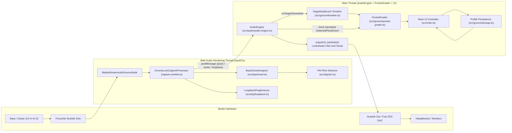
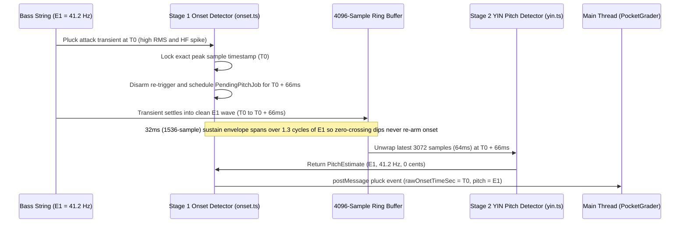

# GrooveLock — Architecture & Engineering Design (`src/DESIGN.md`)

Welcome! This document is the starting point for engineers and AI agents working on **GrooveLock**.
It explains **what** the system does, **why** specific Web Audio and DSP design choices were made,
and **how** data flows from a bass/guitar pickup to micro-timing pocket grades.

---

## 1. System Overview & Core Problem

**GrooveLock** is a studio-grade rhythm ("playing tight in the pocket") and pitch trainer for bass
and guitar players using a USB audio interface (such as a **Focusrite Scarlett Solo 3rd/4th Gen**)
and an external DAC (such as a **Fosi Audio ZD3**).

To grade a bass player's micro-timing with **$\pm 1\text{ ms}$ accuracy** inside a browser, the
system must overcome four classic Web Audio and low-frequency DSP pitfalls:

1. **Zero-Crossing Re-Triggering on Low Bass Strings:**
   - At $48\text{ kHz}$, a standard Web Audio `AudioWorklet` render quantum is **128 samples
     ($2.67\text{ ms}$)**.
   - However, an open 4-string bass $\text{E}_1$ string vibrates at **$41.20\text{ Hz}$** (a wave
     period of **$24.3\text{ ms}$**, or **$1,165\text{ samples}$**), and a 5-string bass
     $\text{B}_0$ vibrates at **$30.87\text{ Hz}$** (**$32.4\text{ ms}$**, or
     **$1,555\text{ samples}$**).
   - If an onset detector measures envelope release on 128-sample blocks, the block RMS drops near
     $0$ every $12.1\text{ ms}$ as the bass waveform crosses zero—causing a single sustained
     $\text{E}_1$ note to falsely re-trigger dozens of times!
2. **Pitch vs. Timing Trade-Off on Plucked Strings:**
   - The first $20\text{–}40\text{ ms}$ of a bass pluck is a broadband percussive transient (fret
     clank, finger/pick scrape) before settling into a clean periodic waveform.
   - Waiting $66\text{ ms}$ to detect the note would ruin timing accuracy, whereas running YIN pitch
     detection at $t = 0\text{ ms}$ produces wild octave/aperiodic errors.
3. **Browser Software Monitoring Echo:**
   - Connecting an input node (`MediaStreamAudioSourceNode`) or legacy `ScriptProcessorNode` to
     `audioCtx.destination` plays the dry bass back through the browser with
     $20\text{–}68\text{ ms}$ of OS/FIFO delay, creating a disorienting slapback echo against the
     Scarlett's zero-latency hardware **Direct Monitor**.
4. **Chromium USB Input/Output Clock Lock (`setSinkId` failure):**
   - In Chromium on macOS/Windows, calling `ctx.createMediaStreamSource(scarlettStream)` binds that
     `AudioContext`'s hardware clock to the Scarlett USB input device. Subsequent calls to
     `ctx.setSinkId(fosiDacId)` on the _same_ `AudioContext` fail to route the click track to a
     separate USB DAC.

---

## 2. High-Level Architecture & Data Flow

GrooveLock separates **pure `Float32Array` DSP**, **real-time Web Audio worklet capture**,
**timeline/pocket grading**, and **DOM presentation** into four strictly typed layers:



---

## 3. Directory & Module Responsibilities

| File                                                         | Layer         | Responsibility                                                                                                                                                                                                                                      |
| :----------------------------------------------------------- | :------------ | :-------------------------------------------------------------------------------------------------------------------------------------------------------------------------------------------------------------------------------------------------- |
| [`src/dsp/types.ts`](./dsp/types.ts)                         | DSP           | Shared immutable data contracts (`PitchEstimate`, `DetectedPluckEvent`, `MeterSnapshot`, `LoopbackSummary`) and discriminated unions (`MainToWorkletMessage`, `WorkletToMainMessage`).                                                              |
| [`src/dsp/pitch-utils.ts`](./dsp/pitch-utils.ts)             | DSP           | 12-TET frequency $\leftrightarrow$ MIDI note/cents conversion (`frequencyToPitchEstimate`), instrument frequency bounds (`getFrequencyBounds`), and Circle of Fourths constants.                                                                    |
| [`src/dsp/yin.ts`](./dsp/yin.ts)                             | DSP           | Pure `Float32Array` YIN autocorrelation pitch detector (`detectPitchYINFromLinear`) with Cumulative Mean Normalized Difference Function (CMNDF) and parabolic interpolation over a 3,072-sample ($64\text{ ms}$) window.                            |
| [`src/dsp/onset.ts`](./dsp/onset.ts)                         | DSP           | `BassOnsetAnalyzer`: Two-stage onset + delayed pitch analyzer using a 4,096-sample ring buffer, a $32\text{ ms}$ ($1,536\text{-sample}$) cycle-integrated sustain envelope, and a high-frequency first-difference transient gate ($s[n] - s[n-1]$). |
| [`src/dsp/loopback.ts`](./dsp/loopback.ts)                   | DSP           | `LoopbackPingDetector`: Sample-accurate sonar ping detector that measures ambient pre-ping noise in $[-45\text{ ms}, -2\text{ ms}]$ and detects leading-edge return arrival in $[+1\text{ ms}, +125\text{ ms}]$ across 6 pulses.                    |
| [`src/audio/capture.worklet.ts`](./audio/capture.worklet.ts) | Audio Thread  | `GrooveLockCaptureProcessor`: Real-time `AudioWorkletProcessor` hosting `BassOnsetAnalyzer` and `LoopbackPingDetector` off the main thread. Configured with `numberOfOutputs: 0`.                                                                   |
| [`src/audio/drum-synth.ts`](./audio/drum-synth.ts)           | Audio Engine  | `StudioDrumSynth`: Procedural Web Audio synthesizer generating Kick, Snare, Hi-Hat, and Studio Click transients on `outputCtx` with zero external sample files.                                                                                     |
| [`src/audio/audio-engine.ts`](./audio/audio-engine.ts)       | Audio Engine  | `AudioEngine`: Manages the decoupled `inputCtx` + `outputCtx` lifecycle, Scarlett channel auto-detection, `setSinkId()` output switching, $25\text{ ms}$ lookahead metronome scheduling, and cross-context clock translation.                       |
| [`src/groove/timeline.ts`](./groove/timeline.ts)             | Groove Domain | Defines the universal `TargetNoteEvent` timeline contract, drill target generators (`computeBarTarget`), and gap-click bar muting (`isBarSilentInGapMode`).                                                                                         |
| [`src/groove/patterns.ts`](./groove/patterns.ts)             | Groove Domain | Defines syncopated `GroovePatternId` templates (Motown, Funk 16th, Swung Shuffle, 8th Pulse), `ClickPlacementMode` (Backbeat 2&4, One-Drop 1, Off-Beat `&`), and `PocketFeelOffsetMs`.                                                              |
| [`src/groove/pocket-grader.ts`](./groove/pocket-grader.ts)   | Groove Domain | `PocketGrader`: Matches latency-compensated plucks against `TargetNoteEvent`s, applies intentional pocket feel offsets, tracks Speed Trainer bar windows, and computes session statistics (`inPocketPct`, `meanOffsetMs`, $\sigma$ `stdDevMs`).     |
| [`src/groove/storage.ts`](./groove/storage.ts)               | Persistence   | Schema-validated `localStorage` load/save for `GrooveLockProfile` (`groovelock.profile.v1`).                                                                                                                                                        |
| [`src/main.ts`](./main.ts)                                   | UI Controller | Binds DOM controls, keyboard shortcuts (`Space`, `R`), calibration workflows, and visual scopes to `AudioEngine` and `PocketGrader`. Uses safe DOM APIs (`textContent`, `createElement`, `replaceChildren`) exclusively.                            |

---

## 4. Deep-Dive: Key Engineering Mechanisms

### 4.1 Dual-`AudioContext` Architecture & Cross-Clock Translation

Inside [`AudioEngine`](./audio/audio-engine.ts):

- **`inputCtx`:** Created specifically for `createMediaStreamSource(scarlettStream)` and
  `AudioWorkletNode('groove-lock-capture', { numberOfInputs: 1, numberOfOutputs: 0 })`. Where
  supported, `inputCtx.setSinkId({ type: 'none' })` is also called. Because the worklet has `0`
  outputs and is never connected to `inputCtx.destination`, **zero instrument audio is ever played
  back by Chrome**.
- **`outputCtx`:** A pure synthesis `AudioContext` with no media input stream attached. Calling
  `outputCtx.setSinkId(sinkDeviceId)` switches click track and calibration ping playback
  instantaneously between the Focusrite Scarlett Solo, Fosi Audio ZD3 DAC, or macOS System Default.
- **Clock Translation:** Whenever a `pluck` message arrives from `inputCtx`'s worklet with timestamp
  $t_{\text{in}}$, `AudioEngine` translates it into `outputCtx` time via:
  $$t_{\text{out}} = t_{\text{in}} + (\text{outputCtx.currentTime} - \text{inputCtx.currentTime})$$
  And inversely, when scheduling loopback sonar pings on `outputCtx`, emission timestamps are
  translated into `inputCtx` time before being sent to `LoopbackPingDetector`.

### 4.2 Two-Stage Bass Onset & Sustain Immunity (`BassOnsetAnalyzer`)



Why this two-stage pipeline works so well on bass:

1. **Micro-Timing Accuracy (`T0`):** The onset timestamp `rawOnsetTimeSec` is locked at the exact
   sample of the initial pick/finger transient (`T0`), before any pitch window delay.
2. **Sustain Immunity (`SUSTAIN_WINDOW_SAMPLES = 1536`):** Re-arming (`armedForOnset = true`) is
   gated on a $32\text{ ms}$ ($1,536\text{-sample}$) RMS envelope rather than the $2.67\text{ ms}$
   block RMS. Since $32\text{ ms} > 24.3\text{ ms}$ (one full cycle of $\text{E}_1$), waveform
   zero-crossings never dip the sustain envelope.
3. **Legato / Ringing Re-Pluck Detection:** If the player plucks a ringing string again before it
   decays to silence, `isRePluckOnRingingString` fires when the fast block RMS jumps above the
   decayed sustain minimum (`activeRms > minSustainEnv * 1.35`) **and** is accompanied by a
   high-frequency first-difference spike (`hfRms > smoothHfRms * 2.1`, computed from
   $s[n] - s[n-1]$).
4. **Low-Frequency YIN Window (`YIN_WINDOW_SIZE = 3072`):** At $t = T_0 + 66\text{ ms}$, the latest
   $3,072$ samples ($64\text{ ms}$) in the ring buffer belong entirely to the new note and provide a
   $1,360$-sample integration window plus up to $1,660$ samples of lag ($\tau_{\max}$), resolving
   fundamentals all the way down to $28.9\text{ Hz}$ ($\text{B}_0 = 30.87\text{ Hz}$).

### 4.3 Scarlett Solo 3rd Gen vs. 4th Gen Channel Auto-Selection

- **Focusrite Scarlett Solo 4th Gen** maps the front-panel $\frac{1}{4}\text{"}$ Hi-Z `INST` jack to
  **Input 1 (`ch0`)** and the rear XLR mic jack to **Input 2 (`ch1`)**.
- **Focusrite Scarlett Solo 3rd Gen** maps the front-panel $\frac{1}{4}\text{"}$ Hi-Z `INST` jack to
  **Input 2 (`ch1`)**.
- Defaulting `channelMode` to `'auto'` compares `rmsCh0 >= rmsCh1 ? ch0 : ch1` on every block so
  both generations work out of the box without manual channel switching.

---

## 5. Extending GrooveLock (Future Play-Along / Tab Roadmap)

`PocketGrader` ([`src/groove/pocket-grader.ts`](./groove/pocket-grader.ts)) is intentionally
decoupled from the metronome. It grades plucks against any stream of
[`TargetNoteEvent`](./groove/timeline.ts) objects:

```ts
export interface TargetNoteEvent {
  readonly id: string;
  readonly timeSec: number;
  readonly barNumber: number;
  readonly beatInBar: number;
  readonly subIndex: number;
  readonly beatLabel: string;
  readonly expectedNote: NoteClass | "ANY";
  readonly isSilentGapBar: boolean;
  readonly stringAndFret?: {
    readonly stringNumber: number;
    readonly fret: number;
  };
}
```

To add a **Song / YouTube Play-Along Mode** in the future:

1. Create a beatmap/tab scheduler that maps song timestamps to `outputCtx.currentTime` and calls
   `grader.pushTargetEvent(event)`.
2. `PocketGrader.evaluatePluck()` will automatically grade timing offsets, note accuracy, and
   session consistency ($\sigma$) against the song's bassline with zero changes to the DSP or
   grading core.

---

## 6. Verification & Testing Guide

All DSP and grading logic is covered by deterministic Vitest unit tests in
[`tests/dsp.test.ts`](../tests/dsp.test.ts) and
[`tests/pocket-grader.test.ts`](../tests/pocket-grader.test.ts).

Run the full verification suite before committing any changes:

```bash
npm run typecheck   # Strict tsc --noEmit verification
npm test            # Vitest unit test suite (DSP + PocketGrader)
npm run build       # Production Vite bundle verification
```
